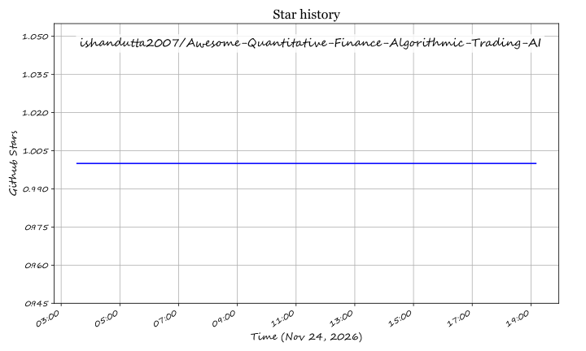

# Awesome-Quantitative-Finance-Algorithmic-Trading-AI

## Top Quantitative Finance & Algorithmic Trading AI Ecosystem

**Curated List of SaaS Products & Open-Source GitHub Projects**  

*Focused on AI Trading Agents, Backtesting Engines, Quantitative Research, Market Data APIs & Execution Frameworks*  

**Last updated: November 2026**

This repository tracks notable **SaaS platforms** and **open-source projects** for **Quantitative Finance & Algorithmic Trading AI**. These tools enable automated strategy discovery, event-driven and vectorized backtesting, multi-agent LLM financial research, deep reinforcement learning for portfolio optimization, and low-latency brokerage execution.

**Examples** include QuantConnect, TradeStation, Alpaca, MetaTrader, TradingView, Interactive Brokers, NinjaTrader, TrendSpider, Portfolio123, Composer, and `HKUDS/Vibe-Trading` (the category leaders). 

**Open-source emphasis**: This section is heavily expanded with every major active project for self-hosted backtesting engines, LLM-driven quantitative trading agents, factor research libraries, and open-source execution bots — ideal for quant researchers, algorithmic traders, financial engineers, and AI developers.

Contributions welcome! Open a PR to add/update entries. Keep descriptions factual and link to official sites.

## Table of Contents

- [SaaS/Hosted Platforms](#saashosted-platforms)

- [Open-Source GitHub Projects](#open-source-github-projects)

- [How to Contribute](#how-to-contribute)

- [Disclaimer](#disclaimer)

## SaaS/Hosted Platforms

- **[QuantConnect](https://quantconnect.com)**  

  Cloud-hosted algorithmic trading and quantitative research platform powered by the LEAN engine with institutional tick-level datasets.

- **[TradeStation](https://tradestation.com)**  

  Brokerage and algorithmic trading platform featuring EasyLanguage strategy automation, backtesting, and direct market access.

- **[Alpaca](https://alpaca.markets)**  

  Developer-first commission-free stock, options, and crypto brokerage API built specifically for algorithmic trading applications.

- **[MetaTrader 5 (MetaQuotes)](https://metatrader5.com)**  

  Widely adopted multi-asset trading platform supporting MQL5 Expert Advisors (EAs), strategy optimization, and automated execution.

- **[TradingView](https://tradingview.com)**  

  Cloud charting, social market analysis, and Pine Script strategy backtesting and webhook alert platform.

- **[Interactive Brokers (IBKR API / Client Portal)](https://interactivebrokers.com)**  

  Global institutional-grade multi-asset brokerage offering TWS, FIX, and REST APIs for automated global execution across equities, futures, and FX.

- **[NinjaTrader](https://ninjatrader.com)**  

  Commercial futures and forex trading platform offering C#-based NinjaScript automated strategy development and tick-level replay.

- **[TrendSpider](https://trendspider.com)**  

  AI-assisted technical analysis platform featuring automated pattern recognition, multi-timeframe backtesting, and no-code trading bots.

- **[Portfolio123](https://portfolio123.com)**  

  Quantitative fundamental screening, factor ranking, and survivorship-bias-free portfolio backtesting platform.

- **[Composer](https://composer.trade)**  

  No-code and AI-assisted automated trading platform allowing users to build, backtest, and execute systematic "symphony" portfolios.

## Open-Source GitHub Projects

- **[HKUDS/Vibe-Trading](https://github.com)**  

  Open-source AI-native quantitative trading and financial agent framework combining LLM reasoning, market intelligence, and automated strategy workflows.

- **[QuantConnect LEAN](https://github.com)**  

  Open-source, event-driven algorithmic trading engine supporting C# and Python for local research, backtesting, and live multi-brokerage trading.

- **[NautilusTrader](https://github.com)**  

  High-performance, event-driven algorithmic trading platform and backtester written in Rust with Python bindings, offering identical code for backtest and live execution.

- **[Qlib (Microsoft)](https://github.com)**  

  AI-oriented open-source quantitative investment platform covering the full ML pipeline from alpha factor mining to risk modeling and portfolio optimization.

- **[FinRL (AI4Finance Foundation)](https://github.com)**  

  Open-source Deep Reinforcement Learning (DRL) framework designed for automated stock trading, portfolio allocation, and market simulation.

- **[TradingAgents (TauricResearch)](https://github.com)**  

  Multi-agent LLM financial trading framework simulating analyst, researcher, trader, and risk-management roles for collaborative market decisions.

- **[RD-Agent (Microsoft)](https://github.com)**  

  Open-source autonomous R&D agent framework capable of iteratively proposing, coding, and backtesting quantitative alpha factors and financial models.

- **[VectorBT](https://github.com)**  

  Blazing-fast open-source vectorized backtesting and quantitative analysis library built on NumPy, Pandas, and Numba for rapid strategy hyperparameter sweeps.

- **[Backtrader](https://github.com)**  

  Feature-rich open-source Python backtesting and live trading framework with extensive built-in indicators, analyzers, and broker integrations.

- **[Zipline-Reloaded](https://github.com)**  

  Actively maintained open-source Pythonic algorithmic trading library originally created by Quantopian for event-driven equity backtesting.

- **[Freqtrade](https://github.com)**  

  Free, open-source crypto trading bot written in Python featuring FreqAI adaptive machine learning, hyperopt parameter optimization, and Telegram/WebUI control.

- **[Hummingbot](https://github.com)**  

  Open-source modular framework for building and running high-frequency market-making, arbitrage, and directional strategies across CEXs and DEXs.

- **[Jesse](https://github.com)**  

  Advanced open-source algorithmic trading framework focused on clean Python syntax, multi-timeframe analysis, and AI/ML strategy optimization.

- **[OpenBB Platform](https://github.com)**  

  Open-source investment research infrastructure aggregating equity, options, macro, crypto, and alternative financial data for Python and AI agents.

- **[CCXT (CryptoCurrency eXchange Trading Library)](https://github.com)**  

  Essential open-source unified API library connecting algorithmic trading engines to over 100 cryptocurrency exchanges worldwide.

- **[TA-Lib & Pandas-TA](https://github.com)**  

  Foundational open-source technical analysis libraries providing 150+ high-speed financial indicators and candlestick pattern recognition functions.

- **[QuantStats](https://github.com)**  

  Open-source Python library for portfolio analytics, calculating Sharpe/Sortino ratios, drawdowns, Win/Loss metrics, and generating tear-sheet reports.

### Additional Strong Open-Source Options

- **[GS-Quant (Goldman Sachs)](https://github.com)** for open-source quantitative finance risk modeling, derivatives pricing, and time-series analytics.

- **[mlfinlab / Hudson & Thames Open-Source Tools](https://github.com)** and **[Riskfolio-Lib](https://github.com)** for hierarchical risk parity (HRP), mean-variance, and convex portfolio optimization.

- **[Barretenberg / StockSharp](https://github.com)** for open-source C# algorithmic trading connectors across global equities, futures, and FX brokers.

- **[FinGPT (AI4Finance)](https://github.com)** for open-source financial LLMs, sentiment analysis, and earnings-call intelligence pipelines.

- Many community **Indian market broker wrappers (`OpenAlgo` / `SmartAPI` / `KiteConnect` utilities)**, **MCP financial data servers**, and **order-book LOB simulators** for quantitative research.

**Frameworks for building custom systems**: Combine **OpenBB**, **Qlib / VectorBT**, **NautilusTrader** or **QuantConnect LEAN**, and **Riskfolio-Lib** with **HKUDS/Vibe-Trading** or **TradingAgents** for end-to-end, AI-driven quantitative research and execution pipelines.

## How to Contribute

1. Fork the repo.

2. Add/edit entries in `README.md` (follow existing format).

3. Include: name, link, 1–2 sentence description, and whether it's SaaS or open-source.

4. Submit PR with a short explanation.

Star the repo if you find it useful!

## Disclaimer

- This is a **community-curated** list — not exhaustive and not an endorsement.

- **Not Financial Advice**: All software, models, and trading agents listed here are for educational, research, and engineering purposes only. Algorithmic trading carries substantial risk of financial loss; past backtested performance does not guarantee future live results.

- Always account for slippage, transaction fees, look-ahead bias, overfitting, and local regulatory compliance before deploying capital.

---

**Made for quantitative researchers, algorithmic traders, financial engineers, and AI agent developers.**  

Let's make quantitative finance more transparent, reproducible, and open.

## Star History

<a href="https://star-history.com/#ishandutta2007/Awesome-Quantitative-Finance-Algorithmic-Trading-AI&Timeline" align="center">
  <picture>
    <source media="(prefers-color-scheme: dark)" srcset="assets/ishandutta2007_Awesome-Quantitative-Finance-Algorithmic-Trading-AI_growth.svg">
    
  </picture>
</a>
