# 📈 Awesome Quantitative Finance & Algorithmic Trading AI 🤖

  <strong>Curated ecosystem of SaaS platforms, AI trading agents, backtesting engines, quantitative research libraries, market data APIs, and low-latency execution frameworks.</strong>

  
  
  
  
  
  

---

## 📑 Table of Contents
- [📊 Sector Overview & Market Dynamics](#-sector-overview--market-dynamics)
- [🏢 SaaS & Hosted Platforms](#-saas--hosted-platforms)
- [💻 Open-Source GitHub Projects](#-open-source-github-projects)
  - [⭐ Featured Open-Source Projects](#-featured-open-source-projects)
  - [🚀 Additional High-Impact Open-Source Frameworks](#-additional-high-impact-open-source-frameworks)
- [🤝 How to Contribute](#-how-to-contribute)
- [💖 Support & Sponsorship](#-support--sponsorship)
- [⭐ Star History](#-star-history)
- [⚠️ Disclaimer](#️-disclaimer)

---

## 📊 Sector Overview & Market Dynamics

The global algorithmic trading and quantitative finance software market is estimated at **$16.8 billion in 2024** and is projected to expand to **$36.2 billion by 2032** (growing at a CAGR of ~10.1%), propelled by cloud-native backtesting engines, low-latency execution APIs, and the exponential adoption of autonomous LLM reasoning agents and deep reinforcement learning (DRL) for alpha discovery. 

The sector exhibits **moderate fragmentation across research, retail algorithmic bot platforms, and analytics**, where specialized innovators (e.g., Pine Script charting, no-code visual symphonies, and vectorized factor mining) compete dynamically, while remaining **highly concentrated (oligopolistic) in institutional prime brokerage and multi-asset direct market access (DMA)**, where deep capital reserves, exchange co-location, and regulatory moats create formidable barriers to entry.

---

## 🏢 SaaS & Hosted Platforms

A ranked breakdown of industry-leading commercial platforms and hosted developer infrastructure, sorted in descending order by enterprise valuation / market capitalization.

| Rank | Platform | Valuation / Company Size | Pricing (Starting Paid Tier) | Free Tier Limits / Trial Specifics | Core Focus & Capabilities |
| :---: | :--- | :--- | :--- | :--- | :--- |
| 1 | **[Interactive Brokers (IBKR)](https://interactivebrokers.com)** | **$55B+ Market Cap** (NASDAQ: IBKR) | **$0 / month** ($0.005/share IBKR Pro tier; $10/mo inactivity fee waived) | **Free Paper Trading Account**: Unlimited real-time simulated testing with $1M virtual cash upon registration | Institutional-grade multi-asset brokerage offering TWS, FIX, Client Portal, and Python/C++ REST APIs across 150+ global exchanges. |
| 2 | **[TradeStation](https://tradestation.com)** | **~$1.4B Valuation** (Monex Group subsidiary) | **$10 / month** (or waived with min. equity / trading volume) | **90-Day Free Simulated Paper Trading Account** with delayed tick data and full EasyLanguage IDE access | Full-featured algorithmic workstation and brokerage supporting EasyLanguage strategy automation, matrix order routing, and tick-level backtesting. |
| 3 | **[TradingView](https://tradingview.com)** | **$3.0B Valuation** (Last round) | **$14.95 / month** (Essential Tier billed annually at $155.40/yr) | **Free Forever Basic Plan**: 1 chart per layout, 3 indicators per chart, 1 active server-side alert, and 30-day historical bar replay | Cloud charting and social network offering Pine Script strategy backtesting, multi-timeframe analysis, and webhook-driven webhook alerts. |
| 4 | **[Alpaca](https://alpaca.markets)** | **~$500M Valuation** (Series B) | **$9 / month** (Market Data Plus plan for full consolidated SIP feeds) | **Free Forever Developer Plan**: Unlimited paper trading API, 200 req/min REST API limit, IEX 15-min delayed stock & real-time crypto data | Developer-first, commission-free stock, options, and crypto brokerage API engineered specifically for autonomous trading bots and fintech apps. |
| 5 | **[NinjaTrader](https://ninjatrader.com)** | **~$350M Valuation** (NinjaTrader Group) | **$99 / month** (or lifetime license purchase at $1,499) | **Free Forever Simulation Edition**: Unlimited simulated futures/forex paper trading, advanced charting, and NinjaScript C# IDE (live trades require license) | Dedicated futures and forex platform featuring C#-based NinjaScript strategy development, order flow market depth, and high-precision tick replay. |
| 6 | **[TrendSpider](https://trendspider.com)** | **~$80M Valuation** (Bootstrapped / Private) | **$39.50 / month** (Essential Plan billed annually at $474/yr) | **7-Day Full-Access Free Trial**: Complete access to real-time market data, multi-timeframe backtesting, and automated bots | AI-assisted technical analysis platform with automated trendline detection, multi-timeframe strategy backtesting, and no-code trading bots. |
| 7 | **[QuantConnect](https://quantconnect.com)** | **~$60M Valuation** (Venture-backed) | **$20 / month** (Researcher Seat for institutional data & expanded cloud compute) | **Free Forever Community Tier**: Unlimited local LEAN CLI backtesting, free Daily/Minute equity data, 1 concurrent cloud backtest job | Institutional cloud research and algorithmic backtesting platform powered by the LEAN engine, offering point-in-time tick data and multi-broker live deployment. |
| 8 | **[Composer](https://composer.trade)** | **~$40M Valuation** (Series A) | **$24 / month** (Pro Plan billed annually at $288/yr) | **14-Day Free Trial of Pro**: Unlimited backtesting, AI strategy prompt generation, and automated portfolio rebalancing | No-code algorithmic investment platform allowing users to build, backtest, and automate logic-based "symphony" portfolios with AI natural language prompts. |
| 9 | **[Portfolio123](https://portfolio123.com)** | **~$30M Valuation** (Private) | **$50 / month** (Screener Tier billed annually at $600/yr) | **15-Day Free Trial**: Complete access to point-in-time databases, factor ranking systems, and survivorship-bias-free equity backtesting | Fundamental screening, quantitative factor ranking, and institutional-grade backtesting with over 25 years of survivorship-bias-free accounting data. |
| 10 | **[MetaTrader 5 (MetaQuotes)](https://metatrader5.com)** | **Private / Bootstrapped** (~$150M+ ARR) | **$0 / month for Traders** (Brokers pay white-label license from $5,000/mo) | **Free Forever Client Terminal**: Full MQL5 development IDE, distributed strategy tester agent network, and demo broker accounts | Global standard multi-asset trading client supporting MQL5 algorithmic Expert Advisors (EAs), algorithmic grid search, and low-latency execution. |

---

## 💻 Open-Source GitHub Projects

A comprehensive index of open-source algorithmic trading frameworks, LLM financial agents, backtesting engines, and quantitative toolkits, sorted in descending order by GitHub stargazers.

### ⭐ Featured Open-Source Projects

| Stars | Project | Framework Focus | Description |
| :---: | :--- | :--- | :--- |
|  | **[TradingAgents](https://github.com/TauricResearch/TradingAgents)** | Multi-Agent LLM Quant | Multi-agent LLM financial trading framework simulating quantitative researcher, market analyst, execution trader, and risk manager roles for autonomous market decisions. |
|  | **[OpenBB](https://github.com/openbb-finance/OpenBB)** | Investment Research Terminal | Comprehensive open-source investment research infrastructure aggregating equity, options, macro, crypto, and alternative financial data for Python quants and AI workflows. |
|  | **[Freqtrade](https://github.com/freqtrade/freqtrade)** | Automated Crypto Bot | High-performance Python crypto trading bot featuring FreqAI adaptive machine learning, Hyperopt parameter optimization, Telegram controls, and web UI. |
|  | **[Qlib (Microsoft)](https://github.com/microsoft/qlib)** | AI Quantitative Investment | AI-oriented quantitative investment platform covering alpha factor mining, market dynamics modeling, and deep reinforcement learning with RD-Agent automation. |
|  | **[CCXT](https://github.com/ccxt/ccxt)** | Multi-Exchange Trading API | Unified crypto trading API supporting over 100 cryptocurrency exchanges and prediction markets in Python, JavaScript, TypeScript, C#, and Go. |
|  | **[Vibe-Trading (HKUDS)](https://github.com/HKUDS/Vibe-Trading)** | LLM Trading Agent | Open-source AI-native quantitative trading framework utilizing LLM reasoning, social sentiment extraction, and autonomous strategy formulation pipelines. |
|  | **[NautilusTrader](https://github.com/nautechsystems/nautilus_trader)** | High-Frequency Rust Engine | Production-grade, event-driven algorithmic trading engine written in Rust with Python bindings, guaranteeing zero-discrepancy backtesting and live execution. |
|  | **[Backtrader](https://github.com/mementum/backtrader)** | Event-Driven Backtesting | Clean, modular Python backtesting and live trading framework with extensive built-in technical indicators, sizers, observers, and interactive plotting. |
|  | **[QuantConnect LEAN](https://github.com/QuantConnect/Lean)** | Multi-Asset Trading Engine | Open-source, institutional event-driven algorithmic engine in C# and Python supporting equities, FX, CFDs, options, and futures with direct broker routing. |
|  | **[FinGPT](https://github.com/AI4Finance-Foundation/FinGPT)** | Financial LLM Framework | Open-source financial large language models and automated data pipelines democratizing financial sentiment, robo-advising, and algorithmic signals. |
|  | **[Hummingbot](https://github.com/hummingbot/hummingbot)** | Market Making & Arbitrage | Modular open-source CLI framework for running cross-exchange market making, triangular arbitrage, and directional liquidity strategies across CEXs and DEXs. |
|  | **[FinRL](https://github.com/AI4Finance-Foundation/FinRL)** | Deep Reinforcement Learning | Scalable reinforcement learning framework providing DDPG, PPO, SAC, and A2C agent environments for portfolio allocation, execution, and crypto trading. |
|  | **[RD-Agent (Microsoft)](https://github.com/microsoft/RD-Agent)** | Autonomous Alpha R&D | Autonomous R&D agent framework by Microsoft capable of automatically discovering, writing code for, and backtesting quantitative alpha factors and ML models. |
|  | **[GS-Quant (Goldman Sachs)](https://github.com/goldmansachs/gs-quant)** | Quantitative Derivatives & Risk | Institutional Python toolkit created by Goldman Sachs for quantitative derivatives pricing, risk management modeling, and statistical factor analysis. |
|  | **[TA-Lib Python](https://github.com/TA-Lib/ta-lib-python)** | Technical Analysis Indicators | High-performance C-wrapper for TA-Lib providing over 150+ ultra-fast technical indicators including RSI, MACD, Bollinger Bands, and candlestick pattern recognition. |
|  | **[StockSharp](https://github.com/StockSharp/StockSharp)** | C# Quant Trading Suite | Comprehensive algorithmic trading platform and graphical designer with connectors to hundreds of global exchanges, FIX protocols, and brokers. |
|  | **[VectorBT](https://github.com/polakowo/vectorbt)** | Vectorized Backtesting | Ultra-fast vectorized backtesting and factor analysis engine built on NumPy, Pandas, and Numba, allowing millions of parameter combinations to run in seconds. |
|  | **[Backtesting.py](https://github.com/kernc/backtesting.py)** | Backtesting & Optimization | Lightweight, fast Python backtesting engine with an intuitive API, parameter grid search/optimization, and interactive Bokeh HTML tear-sheet visualizations. |
|  | **[Jesse](https://github.com/jesse-ai/jesse)** | Modern Crypto Framework | Advanced algorithmic trading framework focused on clean syntax, multi-timeframe candle operations, genetic optimization, and web dashboard control. |
|  | **[QuantStats](https://github.com/ranaroussi/quantstats)** | Portfolio Analytics & Metrics | Deep portfolio analytics library calculating Sharpe, Sortino, drawdowns, win-rates, CAGR, and automatically generating professional HTML tear-sheet reports. |
|  | **[ta (Technical Analysis)](https://github.com/bukosabino/ta)** | Indicator Feature Engineering | Pure Python technical analysis library with 40+ indicators designed for seamless feature engineering into Pandas DataFrames and ML pipelines. |
|  | **[Riskfolio-Lib](https://github.com/dcajasn/Riskfolio-Lib)** | Portfolio Optimization | Quantitative portfolio optimization and asset allocation library in Python implementing Mean-Variance, CVaR, CDaR, Black-Litterman, and Hierarchical Risk Parity (HRP). |
|  | **[FinTA](https://github.com/peerchemist/finta)** | Pure Pandas Indicators | Lightweight pure Python library implementing over 80 common financial technical analysis indicators natively using Pandas Series and DataFrames. |
|  | **[Zipline-Reloaded](https://github.com/stefan-jansen/zipline-reloaded)** | Event-Driven Quant Engine | Modernized continuation of Quantopian's Zipline backtesting engine, fully updated for modern Python, NumPy, Pandas, and point-in-time factor analysis. |

---

### 🚀 Additional High-Impact Open-Source Frameworks

- **[Hudson & Thames MLFinLab](https://github.com/hudson-and-thames/mlfinlab)** — Implementation of machine learning techniques for quantitative finance based on Marcos López de Prado's research (fractional differentiation, triple-barrier labeling, microstructural features).
- **[PyPortfolioOpt](https://github.com/robertmartin8/PyPortfolioOpt)** — Financial portfolio optimization in Python, including Efficient Frontier, Black-Litterman shrinkage covariance, and semi-variance.
- **[OpenAlgo](https://github.com/marketcalls/openalgo)** — Open-source algorithmic trading gateway for Indian stock brokers (Zerodha, AngelOne, Upstox, Dhan, Fyers) supporting multi-broker order execution.
- **[yfinance](https://github.com/ranaroussi/yfinance)** — High-reliability financial market data downloader for Yahoo! Finance historical equity, options, and fundamentals datasets.
- **[QuantPy](https://github.com/bukosabino/quantpy)** — Quantitative trading and portfolio management module in Python focusing on risk-adjusted performance attribution.

---

## 🤝 How to Contribute

We welcome contributions from quantitative developers, financial engineers, and algorithmic traders!

1. 🍴 **Fork the repository** on GitHub.
2. 🌿 **Create a new branch** (`git checkout -b feature/new-quant-tool`).
3. 📝 **Add your entry** to the appropriate table or section following the existing formatting conventions.
4. 🔎 **Ensure accuracy**: Include official links, realistic valuation/pricing details, and GitHub star counts.
5. 🚀 **Submit a Pull Request** with a concise description of the tool's relevance to the quant community.

---

## 💖 Support & Sponsorship

If you find this curated quantitative finance and algorithmic trading repository useful:
- ⭐ **Star this repository** to show your support and help other quants discover it!
- 🍴 **Fork and share** with colleagues, trading teams, and quant finance communities.
- ☕ **Sponsor the Maintainer**: Support ongoing curation, data updates, and open-source tooling via the **[GitHub Sponsors Dashboard](https://github.com/sponsors/ishandutta2007)**.

Thank you to all contributors and community sponsors who make quantitative finance more open, transparent, and reproducible! 🚀

---

## ⭐ Star History

---

## ⚠️ Disclaimer

- This repository is a **community-curated directory** created solely for educational, engineering, and academic research purposes.
- **Not Financial Advice**: Algorithmic trading and quantitative investing involve substantial risk of financial loss. Backtested strategy performance does not guarantee future results. Always perform thorough risk evaluation, slippage modeling, and regulatory compliance verification prior to deploying real capital.
